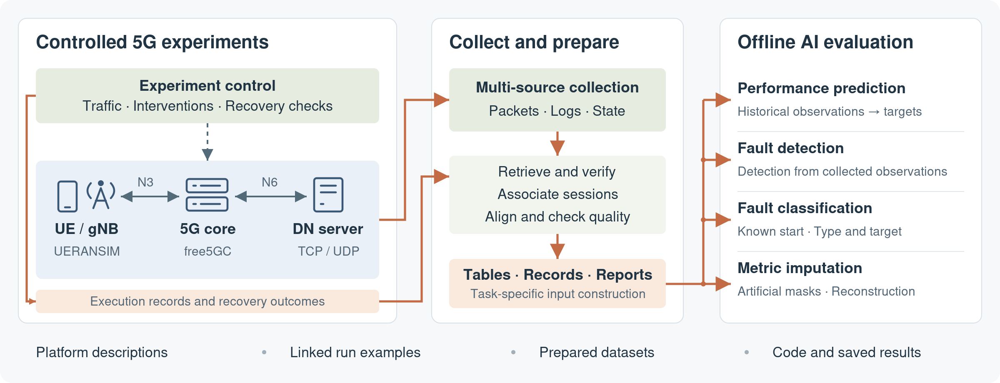

<h1 align="center">D-GATE</h1>

<p align="center">
  <strong>Operational Data Collection and AI Algorithm Performance<br>Validation Benchmark Platform for Core Network</strong><br>
  <sub>Paper appendix materials · Anonymous review</sub>
</p>

<p align="center">
  <a href="manuscript_supplement/README.md">Appendices A–D</a> ·
  <a href="DATA_ACCESS.md">Datasets</a> ·
  <a href="PAPER_RESULT_MAP.md">Paper results</a> ·
  <a href="RUN_GUIDE.md">Reproduction</a>
</p>



*Overview adapted from Fig. 1 of the paper, with the four evaluation tasks added. Collection capabilities and released materials are distinguished below.*

The materials include platform descriptions, linked run examples, prepared datasets, evaluation code, model settings, and saved results.

D-GATE combines configurable traffic, network interventions, recovery checks, and multi-source observations in a 5G core testbed.

## Read the supplementary appendices

The supplement follows the paper’s **single A–D series**. Start with the section relevant to your review; expanded platform evidence is available in the same repository.

| Appendix | What it explains | Start reading |
| :--- | :--- | :--- |
| **A · Platform** | Implementation, deployment, traffic, interventions, and recovery | [Platform and configuration](manuscript_supplement/README.md#appendix-a-platform-implementation-and-configuration) |
| **B · Data** | Data products, field definitions, units, coverage, and examples | [Data organization and examples](manuscript_supplement/README.md#appendix-b-data-organization-fields-and-examples) |
| **C · Task construction** | Task-specific inputs, preprocessing, windows, and data splits | [Task construction](manuscript_supplement/README.md#appendix-c-task-construction) |
| **D · Evaluation** | Models, hyperparameters, seeds, results, and reproduction | [Evaluation settings and results](manuscript_supplement/README.md#appendix-d-evaluation-settings-and-results) |

[Detailed navigation](APPENDIX_NAVIGATION.md) · [Platform evidence index](platform_data/details/INDEX.md) · [Configuration and operation tables](platform_data/tables/README.md)

## Explore the data

The release includes **D01–D07** platform exports and prepared task inputs. The **400-entry field dictionary** covers metrics and contextual fields across data products; each 1 s exported table has **81 columns**.

| To inspect… | Open… |
| :--- | :--- |
| Table formats and field meanings | [1 s sample](manuscript_supplement/data/timeseries_1s_sample.csv) · [5 s sample](manuscript_supplement/data/core_features_5s_sample.csv) · [Field dictionary](manuscript_supplement/data/field_dictionary.csv) |
| One run’s configuration, events, and recovery records | [Linked D06 examples](platform_data/samples/W1-D06/README.md) |
| Included exports and task inputs | [Platform exports and task data](data_machine/README.md) · [Prediction histories and targets](prediction_inputs/README.md) |
| Windows, indices, masks, and preprocessing scales | [Data access and file locations](DATA_ACCESS.md) |

The 1 s exports, 5 s observations, and prediction tables are separate products. Their construction and documented relationships are described in [Appendix C](manuscript_supplement/README.md#appendix-c-task-construction) and the [lineage record](appendix/LINEAGE.md).

## Inspect the four evaluation tasks

| Task | Evaluation setting | Paper result | Code and settings |
| :--- | :--- | :---: | :--- |
| **Performance prediction** | Future network and host metrics from historical observations | Table II | [Prediction](evaluation_package/evaluation/prediction/README.md) |
| **Fault detection** | Offline evaluation of fault detection from collected observations | Table III | [Detection](evaluation_package/evaluation/detection/README.md) |
| **Fault classification** | Known injection start; 12 classes encoding fault type and associated target | Table IV | [Classification](evaluation_package/evaluation/localization/README.md) |
| **Metric imputation** | Reconstruction under fixed artificial missingness patterns | Table V | [Imputation](evaluation_package/evaluation/imputation/README.md) |

D01–D04 are used for training and D05 for selection or calibration; D06/D07 are post-hoc test runs. See the [paper result map](PAPER_RESULT_MAP.md) for supporting files and the [model settings](appendix/E1_models_hyperparameters.md) for task-specific details.

## Recompute, replay, or train

**Quick check — saved prediction and imputation tables.** From the downloaded repository root, run with Python 3:

```bash
python evaluation_package/evaluation/verify_paper_tables.py
```

This checks **9 prediction means and 60 imputation values** against the stored table values to three decimal places. It uses the Python standard library and runs no model inference or training.

For further checks, choose the corresponding workflow in the [run guide](RUN_GUIDE.md):

| Workflow | What it does |
| :--- | :--- |
| **Saved-result recomputation** | Recalculates aggregates or metrics from saved outputs |
| **Checkpoint replay** | Runs inference with supplied models and compares outputs |
| **Fresh training** | Fits new models in a separate run directory |

Dependencies, commands, and task-specific requirements are listed in the [reproduction instructions](appendix/E3_reproduction.md). Fresh runs are separate executions and do not replace the paper’s saved results.

## Release scope

**Included:** appendices, field dictionaries, configurations and linked samples, prepared task inputs, evaluation and offline task-data code, fitted models, and saved outputs.

**Outside this review release:** collection-platform source code, PCAP files, the complete original log archive, and the complete traffic-input corpus. Platform implementation paths and hashes are documentary references; platform source is reserved for release upon acceptance.

[Data availability](DATA_ACCESS.md) · [Detailed delivery scope](platform_data/DELIVERY_STATUS.md) · [Validation records](CHECKS.md) · [Anonymous access status](PUBLICATION_STATUS.md)

All repository documentation and report text is provided in English. Legacy `_ZH` report filenames are retained for compatibility. See the [English revision record](manifests/english_documentation_revision.json) for translation scope and preserved historical hashes.
